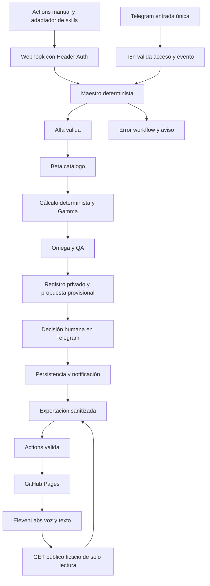

# Arquitectura y transferencia del caso

Un mismo caso_id se conserva dentro del flujo operativo y sus costos. El panel usa alias públicos MUESTRA calculados por orden; la entrega incluye mapa de los casos medidos del corte. No asumir persistencia del alias después de cambios del conjunto. La ruta de voz actual comparte registro, pero falta autenticar su endpoint exclusivo para satisfacer la guía al máximo.

Pages aloja solo web/; los agentes y secretos viven en n8n/OpenAI. Actions publica y ejecuta la entrada manual configurada; no es servidor de conversación. Los skills se cargan en precontrol de Actions, no nativamente en la ruta Telegram. Publicación programada cada seis horas; incluye consultas n8n independientes de los casos. Se conservan errores y versiones históricas como evidencia, no como configuración actual.
